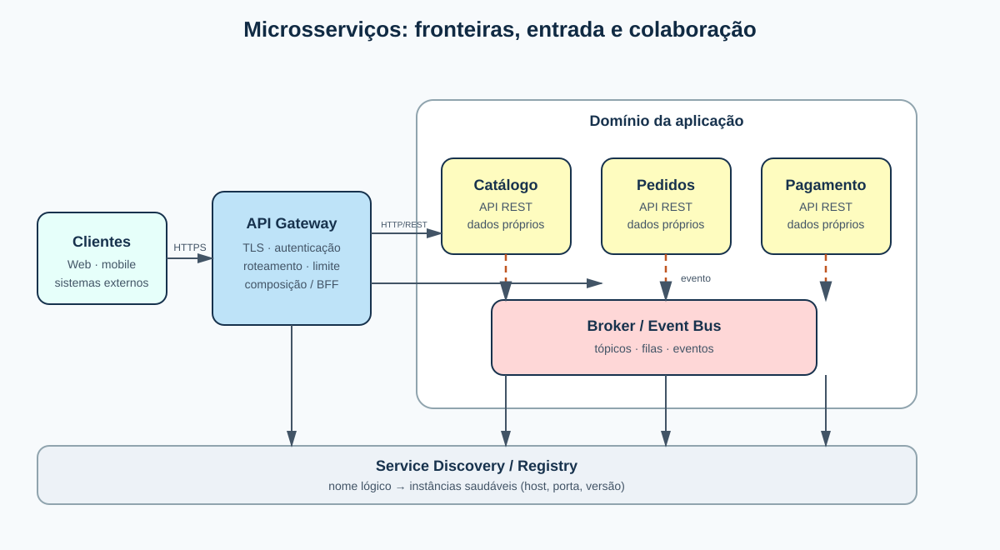
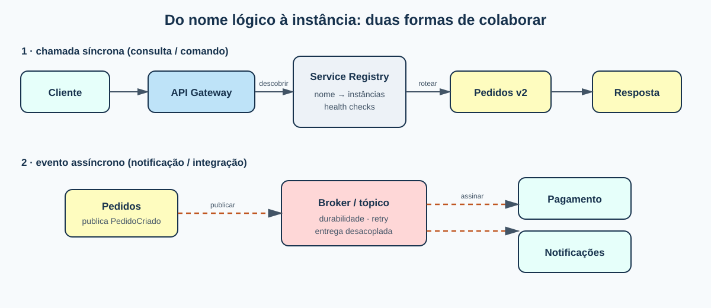

## O problema

- Um sistema cresce além de um único deploy.
- Times precisam evoluir partes diferentes com autonomia.
- Alterações em uma parte podem exigir a reconstrução de toda a aplicação.
- Rede, dados e falhas passam a ser parte do design quando o sistema é distribuído.

> O problema não é simplesmente o tamanho da aplicação, mas a dificuldade de evoluir partes do sistema de forma independente.

---

## O que é um microsserviço?

Uma unidade autônoma, organizada em torno de uma **capacidade de negócio**, com:

- responsabilidade bem definida;
- processo e deploy independentes;
- contrato explícito;
- responsabilidade sobre seus próprios dados;
- equipe capaz de desenvolver e operar o serviço.

> O tamanho é um sinal; a fronteira de negócio e a autonomia são os critérios.

---

## Monólito × microsserviços

### Monólito

```text
+--------------------------------+
|          Aplicação             |
|                                |
| Usuários | Pedidos | Pagamento |
|                                |
+--------------------------------+

```

### Microsserviços

```text

+----------+  +----------+  +-----------+
| Usuários |  | Pedidos  |  | Pagamento |
+----------+  +----------+  +-----------+

```

## Visão da arquitetura

{fig-alt="Arquitetura de referência de microsserviços"}

## Componentes e responsabilidades

| Componente | Responsabilidade |
|---|---|
| API Gateway | entrada, autenticação, roteamento, composição e limites |
| Serviço | regra de negócio, contrato e dados do seu domínio |
| Broker | filas/tópicos, entrega assíncrona e desacoplamento temporal |
| Service Discovery | nome lógico, instâncias e saúde |
| Observabilidade | logs, métricas e traces correlacionados |

## Como decompor o sistema

Comece pelo **domínio**, não pela infraestrutura:

1. Liste capacidades e fluxos de negócio.
2. Agrupe regras que mudam juntas.
3. Defina o que cada serviço possui e o que ele não conhece.
4. Publique contratos pequenos e orientados a casos de uso.
5. Valide as fronteiras com cenários de mudança e falha.

> Um serviço não precisa ser minúsculo: precisa ser **coeso, autônomo e operável**.

## Banco de dados por serviço

Cada serviço mantém responsabilidade sobre seus próprios dados.

```text
Usuário Service
       |
Banco Usuários


Pedido Service
       |
Banco Pedidos


Pagamento Service
       |
Banco Pagamentos

## Comunicação entre serviços

Existem dois modelos principais:

### Síncrono
O consumidor espera uma resposta.

Cliente
   |
   v
Pedido Service
   |
   v
Pagamento Service
   |
   v
Resposta


### Assíncrono
O produtor publica uma mensagem ou evento e continua seu processamento.

Pedido Service
      |
      v
    Broker
     /  \
    v    v
Pagamento  Notificação

## API REST: quando usar

- consultas interativas e comandos que precisam de resposta rápida;
- recursos e verbos HTTP bem definidos;
- idempotência, timeouts, versionamento e erros padronizados;
- OpenAPI como contrato verificável.

**Risco:** uma cadeia longa de chamadas síncronas acopla disponibilidade e latência.

###O risco da cadeia síncrona

Gateway
   ↓
Pedidos
   ↓
Pagamento
   ↓
Estoque
   ↓
Notificações

Cada chamada pela rede adiciona:
- latência;
- possibilidade de falha;
- dependência entre serviços;
- necessidade de timeout e retry.

> Quanto maior a cadeia síncrona, maior a quantidade de componentes envolvidos na mesma resposta.

## Mensageria: quando usar

- eventos de domínio e tarefas demoradas;
- integração publish/subscribe com vários consumidores;
- absorção de picos com filas;
- retry, dead-letter queue e consumidores idempotentes.

**Risco:** consistência eventual, ordenação, duplicatas e rastreabilidade exigem projeto explícito.

## Gateway e Service Discovery

{fig-alt="Comunicação síncrona e descoberta de serviços"}

###API Gateway
- ponto de entrada;
- autenticação;
- roteamento;
- limites;
- composição de respostas.

###Service Discovery
- resolve nomes lógicos;
- localiza instâncias;
- verifica saúde dos serviços;
- evita dependência de IPs efêmeros.

O gateway esconde a topologia interna. O registry resolve o nome lógico para uma instância saudável; nenhum cliente deve depender de IPs efêmeros.

## Deploy independente

No monólito, mudar uma função pode exigir rebuild e reimplantação de toda a aplicação.

Nos microsserviços, uma alteração pode ser publicada apenas no serviço afetado,
desde que seus contratos com os demais serviços continuem compatíveis.

- **Releases menores — ciclos de desenvolvimento mais independentes.
- **Menor impacto por alteração — mudanças ficam mais concentradas.
- **Escala sob demanda — serviços podem ser escalados individualmente.
- **Autonomia de implantação — cada serviço possui seu próprio ciclo de deploy.

> A implantação independente é um dos principais benefícios dos microsserviços, mas exige automação e disciplina operacional.

## Consistência de dados

- Cada serviço tem seu **próprio banco** — não há transação ACID global.
- Operações de negócio atravessam vários serviços e vários bancos.
- Solução comum: **Saga Pattern** — transações locais + compensações.
- Resultado: **consistência eventual**, não imediata.
- Consequência: regras de negócio ficam mais complexas e explícitas.

## Complexidade distribuída

Chamar outro serviço não é chamar uma função: é uma **chamada de rede**.

- Pode falhar, atrasar, duplicar ou chegar fora de ordem.
- Exige **timeout, retry limitado, circuit breaker e fallback**.
- Exige **service discovery** e **health checks**.
- Exige **observabilidade correlacionada** (logs, métricas, traces).

> A complexidade não desaparece: ela migra do código para a operação.

## Trade-offs

| Aspecto        | Benefício                  | Custo                         |
|----------------|----------------------------|-------------------------------|
| Modularidade   | Fronteiras mais claras     | Acoplamento entre serviços    |
| Deploy         | Implantação independente   | Automação e contratos         |
| Escalabilidade | Escala seletiva            | Mais infraestrutura           |
| Tecnologia     | Heterogeneidade            | Complexidade operacional      |
| Comunicação    | Autonomia entre serviços   | Latência e falhas de rede     |
| Dados          | Autonomia dos serviços     | Consistência distribuída      |
| Testes         | Testes isolados            | Integrações mais complexas    |
| Operação       | Serviços independentes     | Monitoramento mais complexo   |

## Vantagens

- **Deploy independente** — cada serviço sobe sozinho, sem rebuildar o sistema todo.
- **Escala independente** — escala só o serviço sob carga, não a aplicação inteira.
- **Autonomia de times** — cada equipe é dona do ciclo de vida do seu serviço.
- **Isolamento de falhas** — a queda de um serviço não derruba necessariamente os demais.
- **Heterogeneidade técnica** — cada serviço pode usar a stack mais adequada.
- **Código pequeno e focado** — mais fácil de entender, testar e evoluir.

## Desvantagens

- **Complexidade distribuída** — rede, latência, timeout, retry, service discovery, tracing.
- **Consistência de dados** — sem ACID entre serviços; exige Saga e consistência eventual.
- **Custo operacional alto** — CI/CD, containers, observabilidade, on-call por serviço.
- **Debug e testes mais difíceis** — um request atravessa vários serviços.
- **Risco de "monólito distribuído"** — se as fronteiras forem mal desenhadas, é o pior dos dois mundos.

> Microsserviços trocam complexidade de código por complexidade de operação. A pergunta não é "é melhor?", é "meu contexto paga esse preço?"

## Decisão prática

1. O consumidor precisa da resposta agora? Comece com REST.
2. Pode concluir depois ou há vários interessados? Publique um evento.
3. Há múltiplos clientes e políticas comuns? Use gateway/BFF.
4. As instâncias mudam? Adote discovery e health checks.
5. Há chamadas remotas? Defina timeout, retry limitado, circuit breaker e trace.

## Quando microsserviços fazem sentido?

Considere a arquitetura quando houver:
- necessidade de evolução independente;
- diferentes partes do sistema com ritmos de mudança distintos;
- equipes que precisam trabalhar com autonomia;
- necessidade de escalabilidade seletiva;
- domínio suficientemente compreendido para definir boas fronteiras.
Evite adotar apenas porque:
- "microsserviços são modernos";
- a aplicação possui muitas APIs;
- existe expectativa de crescimento sem uma necessidade concreta;
- a equipe ainda não possui estrutura para operar um sistema distribuído.

## Exemplo aplicado

Uma plataforma de comércio eletrônico pode ser dividida em:
             API Gateway
                  |
       +----------+----------+
       |          |          |
       v          v          v
    Usuário     Pedido    Pagamento
       |          |          |
       v          v          v
    Banco       Banco      Banco
   Usuários    Pedidos   Pagamentos
                  |
                  v
              Estoque
## Exemplo: pedido criado

Cliente
   |
   v
Pedido Service
   |
   | PedidoCriado
   v
  Broker
  /    \
 v      v
Estoque  Notificação
Service   Service

O evento PedidoCriado permite que diferentes serviços reajam à mesma mudança
sem que o Pedido Service precise conhecer diretamente todos os consumidores.

## Fechamento

Microsserviços não são simplesmente "mais APIs".
São fronteiras de negócio operáveis de forma independente.
O ganho aparece quando:

- as fronteiras são bem definidas;
- os contratos são claros;
- os serviços possuem autonomia;
- a operação distribuída é tratada como parte da arquitetura.

> A questão não é apenas "usar ou não usar microsserviços", mas entender quais problemas a arquitetura resolve e quais custos ela introduz.

## Fontes

Lewis, James; Fowler, Martin — Microservices: a definition of this new architectural term [@fowler2014microservices]
Newman, Sam — Building Microservices: Designing Fine-Grained Systems [@newman2015building]
Richardson, Chris — Microservices Patterns: With Examples in Java [@richardson2018microservices]
Microsoft — Communication in a microservice architecture [@microsoft-communication]
Microsoft — Microservices architecture style [@azure-microservices]
Microsoft — API gateways [@azure-gateway]
Richardson, Chris — Server-side service discovery [@microservices-discovery]

```